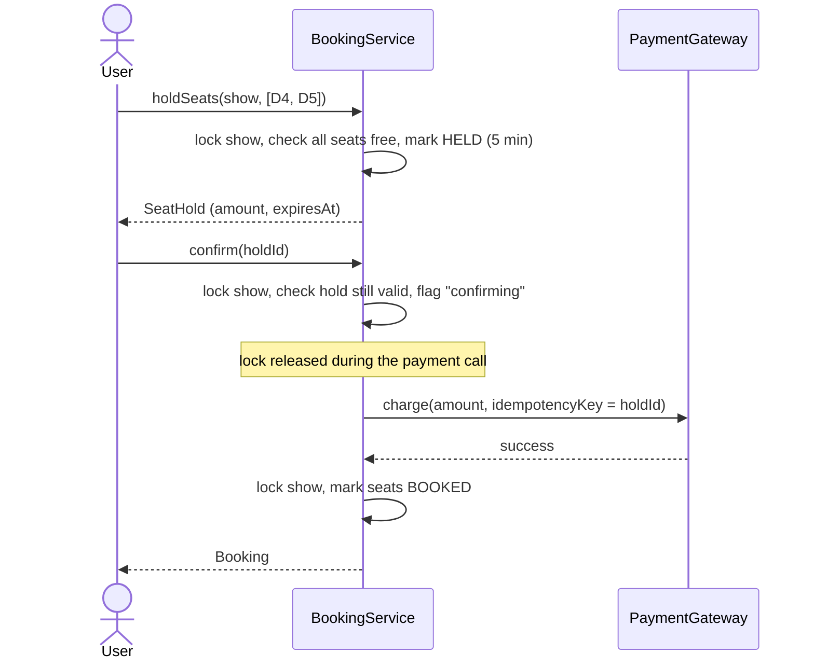

# Movie Seat Booking (BookMyShow-style)

The booking core of a movie ticketing system in plain Java 21. The point of this project is the hard part of the problem: **two people must never get the same seat**, even when hundreds of them click "Book" for the same show at once, and seats must not get stuck if someone abandons checkout.

## Booking flow



If the user never confirms, the hold expires and the seats are free again, either straight away for the next request or when `releaseExpiredHolds()` runs from a scheduler.

## Design decisions

**Seat state as a sealed type**

```java
sealed interface SeatState permits Available, Held, Booked
```

Java 21 pattern matching (`switch` over the sealed interface) makes the compiler check that every state is handled.

**One lock per show**
- A global lock would serialise the whole platform.
- Per-seat locks make multi-seat holds painful: you need lock ordering to avoid deadlocks, plus rollback if seat 3 of 4 is taken.
- Per show is the sweet spot: no contention between shows, and "check all seats then grab all seats" is trivially atomic.

**All-or-nothing holds.** If a user asks for D4 + D5 and D5 is taken, D4 isn't held either. Nobody wants half a booking.

**Don't hold the lock during payment.** The payment call can take seconds. Holding the show lock that long would block every other user of that show. Instead the hold is flagged as *confirming*:
- the sweeper skips it
- expiry doesn't apply to it
- nobody else can take its seats

The lock is re-acquired only for the final state change. `holdDoesNotExpireWhilePaymentIsInProgress` simulates a payment slower than the hold duration, with the sweeper and another user racing in the middle.

**An expired hold must not release someone else's seats.** If Alice's hold expires and Bob grabs the seat, a late `confirm` from Alice must fail *without* freeing Bob's seat. `releaseHold` only frees seats that are still held by that exact hold id (`expiredHoldFreesSeatsAndCannotBeConfirmed`).

**Idempotency, twice:**
- `confirm(holdId)` called again (user double-clicks, client retries after a timeout) returns the same booking.
- The hold id is passed to the payment gateway as the idempotency key, so a retried charge doesn't bill the card twice.

**Money is `long` paise.**

## Tests

- `BookingServiceTest` - flows, expiry, sweeper, payment failure, idempotency, cancellation and refund, validation
- `BookingConcurrencyTest`
  - 100 threads race for one seat: exactly 1 wins
  - 12 threads x 200 overlapping 2-seat requests with random cancellations: no seat sold twice, and every seat ends up either sold or free (none stuck in "held")

## Demo

200 users on virtual threads fight over the back rows of one show:

```
Outcome: {booked=12, seats taken, try again=188}
Seats sold: 26, revenue: Rs 9,200

Seat map (X = booked, . = free):
A  . . . . . . . . . .
B  . . . . . . . . . .
C  . . . . . . . . . .
D  . X X . X X X X . .
E  . X X . X X X X X .
F  X X X X X X X X X .
G  . X X X X .

Every seat sold exactly once: true
```

## Running

```bash
mvn test
mvn compile && java -cp target/classes com.praveen.booking.Demo
```

## Scaling it out

This version keeps state in memory, so it runs on a single instance. With several app servers:

- **Seat state in the DB, guarded by the database itself:**
  - `UPDATE show_seat SET status='HELD', hold_id=?, expires_at=? WHERE show_id=? AND seat_id IN (...) AND (status='AVAILABLE' OR (status='HELD' AND expires_at < now()))`
  - Check that the updated row count equals the number of seats requested, or roll back. It's the same all-or-nothing check, done atomically by the DB.
- **Or Redis** `SET seat:{show}:{seat} {holdId} NX PX 300000` per seat, with a Lua script to make the multi-seat hold atomic.
- **Expiry:** a scheduled job or Redis key expiry instead of the in-process sweeper.
- **Hot shows:** a virtual waiting room / queue in front of booking (first-day-first-show of a big release).
